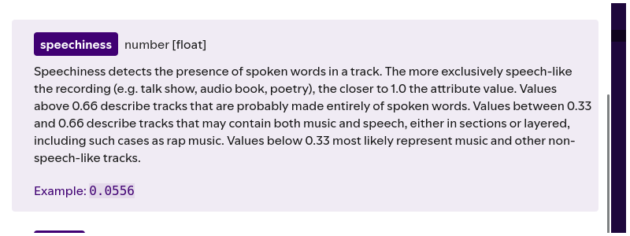

<!-- ## ZADANIE 1 ##

## DANE: ##
https://www.kaggle.com/datasets/maharshipandya/-spotify-tracks-dataset
 Ale ucięte do tylko rap i rock 

## Hipoteza ##
 Model głównie będzie rozróżniać gatunek między rapem (hip-hop w datasecie) a rockiem patrząc na speechiness (ratio mowy w nagraniu) i explicit (boolean, czy występują przekleństwa i inne). Jeśli zabierzemy te dane modelowi, to jego skuteczność spadnie, ale powinien być w stanie nadal w miarę dobrze klasyfikować po rytmie i brzmieniu (danceability, energy, valence)

## Co wyszło na jaw ##
* speechiness (0 - 1) - proporcja mowy w nagraniu (w rapie będzie o dużo wyższa) wg. Spotify:
** < 0.33 - zwykła muzyka, melodyjna, brak samej mowy 
** (0.33; 0.66) - muzyka z obecną mową (jak rap właśnie)
** >= 0.66 - podcasty (głównie mowa)

(https://developer.spotify.com/documentation/web-api/reference/get-audio-features)
  Jednak u nas to jest: 

| track_genre | mean | median | min | max |
|:---|:---|:---|:---|:---|
| hip-hop | 0.137 | 0.096 | 0.024 | 0.621 |
| rock | 0.053 | 0.039 | 0.024 | 0.391 |

Średnia obu gatunków jest mocno pod .33 - w przeciwieństwie do tego co spotify podaje -->

# Rozwiązanie znajduje się w pliku [zadanie.ipynb](zadanie.ipynb) #

 