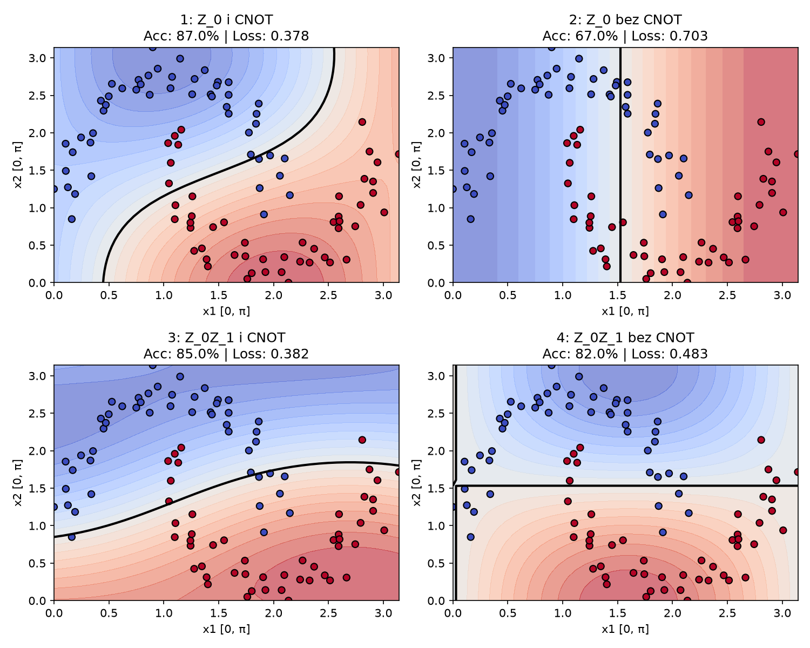
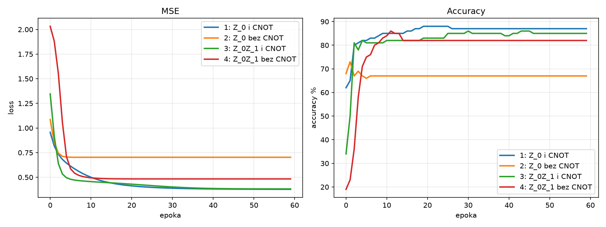

# ZADANIE 3 #

Cezary Kalarus

# MOJA HIPOTEZA #

Dla zbiorów nieliniowych, tj. make_moons, użycie obserwabli $Z_0Z_1$, pozwoli obwodowi o małej ilości warstw (np. L = 1) osiągnąć wyższe accuracy i szybszą zbieżność funkcji loss. Dodatkowo, przy użyciu $Z_0Z_1$ zamiast $Z_0$, usunięcie bramki CNOT z ansatzu, postutkuje znaczmnie mniejszym spadkiem Accuracy, niż przy standardowej $Z_0$.

### Wytłumaczenie ###
W takim zbiorze make_moons mamy dwie cechy. Sam zbiór jest oczywiście nieliniowy, czyli nie ma takiej funkcji liniowej, która by bezbłędnie oddzieliła jeden wynik od drugiego. Aby dobrze móc klasyfikować, model musi znaleźć odpowiednią zależność między dwoma cechami. Skoro mamy akurat dwie cechy to najlepiej jest użyć Angle Encoding - 1 cecha -> 1 kubit - więc wyjdą nam dwa kubity. Jeżeli nasz obwód będzie miał jedną warstwę to będziemy mieli w zasadzie tylko jedną turę rotacji i splątań - jeżeli w takiej sytuacji używalibyśmy obserwabli $Z_0$ - patrzylibyśmy tylko na jeden kubit i to na niego spadałby ten "obowiązek" mieszczenia nie tylko własnej cechy, ale też upchnięcia w sobie (poprzez cnot) informacji o drugiej - no a skoro mamy jedną warstwę, to tylko jedną bramkę splątania - nie będziemy w stanie wystarczająco dobrze tej informacji zakodować. Natomiast używając w tej sytuacji obserwabli globalnej dla tego układu - $Z_0Z_1$ patrzymy tak naprawdę na oba kubity naraz - nie ma konieczności upychania wiedzy z jednego w drugim, bo patrzymy na ich relację. W momencie, gdy nawet zabierzemy z ansatzu bramki splątań, to przez fakt że używamy obserwabli globalnej (nie sprawdzamy pojedyńczego kubitu, tylko relacje obu), mocno zmniejszy to pogorszenie się klasyfikacji modelu - ponieważ nadal będzie sprawdzał obie cechy. Samo $Z_0$, bez splątań sprawdzałoby tak naprawdę tylko jedną cechę, przez co model miałby bardzo niskie accuracy.

## Wyniki eksperymentu [zadanie3.py](zadanie3.py) ##

| Model | Final Loss | Final Acc |
| :--- | :---: | :---: |
| 1: $Z_0$ i CNOT | 0.3776 | 87.0% |
| 2: $Z_0$ bez CNOT | 0.7027 | 67.0% |
| 3: $Z_0Z_1$ i CNOT | 0.3818 | 85.0% |
| 4: $Z_0Z_1$ bez CNOT | 0.4832 | 82.0% |

Za oko, po samych danych z tej tabelki możnaby pomyśleć że głównie to hipoteza się sprawdziła (z małym zgrzytem - $Z_0$ ma o 2 pkt procentowe większe acc od $Z_0Z_1$). Jednak jak popatrzymy na wykresie na granicę decyzyjną różnych naszych modeli oraz na zbieżność MSE, zmienia to cały obraz sytuacji. 
### Granice decyzyjne ###
 

### MSE i Accuracy od epoki treningu ###

Wszystko wygląda na to jakby jakąkolwiek prawdziwą skuteczność miały jedynie modele z bramką CNOT, a acc modelu $Z_0Z_1$ bez niej jest jedynie przypadkiem - bo jego granicą decyzyjną jest prosta linia idealnie na środku. 

### Ale dlaczego $Z_0Z_1$ bez bramki CNOT narysowało prostą linię (prawie) ###
Moim założeniem było, że skoro obserwabla $Z_0Z_1$ sama w sobie sprawdza relację obu kubitów, to i bez bramki splątującej pozwoli modelowi na nieliniową granicę decyzyjną. Wykres wysokościowy jednak pokazuje dwa skupiska naprzeciw sobie - troche, ale niedokońca zgodne z punktami - linia styku między skupiskami jest absolutnie prosta (na lewo z czymś co wygląda jak asymptota pionowa ale naprawde to przedłużenie tej granicy o kolejne skupiska). Ma wzór $f(x_1, x_2) = 0$. Wynika to z mnożenia - bez bramki oba kubity działają niezależnie od siebie. Pierwszy zwraca wartość zależną tylko od $f_1(x_1) = \cos(x_1 + \theta_0 + \theta_2)$ (same mnożenia przez $R_y$), a drugi $f_2(x_2) = \cos(x_2 + \theta_1 + theta_3)$, a $Z_0Z_1$ mnoży to po prostu przez siebie:  
$$f(x_1, x_2) = <Z_0> \cdot <Z_1> = A(x_1) \cdot B(x_2)$$
Tworzy się wtedy szachownica - tam gdzie:  $$f_1(x_1) \cdot f_2(x_2) = 0 <=> f_1(x_1) = 0 \lor f_2(x_2) =0$$, czyli gdzie f1 jest pionowa lub f2 pozioma, jest granica klasyfikatora. Bez cnota model potrafi zrobić tylko to.

Acc = 82% wyszło tak naprawdę przypadkiem - przez ułożenie zbioru make_moons - 2 księżyce leżą akurat na sobie - można je wmiare trafnie oddzielić właśnie prostą. 

Tą sytuację dobrze obrazuje też model $Z_0$ bez cnot, który widzi tylko pierwszy kubit, przez co jedyne co robi to tworzy pionową w $x_1 \approx 1.5$.

## A z jakiego powodu $Z_0Z_1$ z cnotem nie wygrało z $Z_0$ z cnotem ##
Wg. hipotezy założyłem że przy 1 warstwie, 1 cnot nie przekaże informacji z drugiego kubitu na tyle, żeby starczyło to obserwabli lokalnej. Globalna $Z_0Z_1$, z racji że patrzy na relację obu kubitów, miała być w stanie lepiej zakrzywić granicę. Stało się jednak odwrotnie: lokalna ma 87% acc i wydaje się lepiej zakrzywiać granicę (jakby zrobić z punktów obszary, to każdy z nich przecinałaby tylko raz), a globalna ma 85% (i analogicznie przecinałaby każdy po 2 razy). Pokazuje to, że dla lokalnej, sam cnot i $R_y$ po nim starcza, żeby widzieć 2 qubity, a globalna z cnotem "wchodzą sobie lekko w paradę" - cnot już raz uzależnia 1. kubit od 2., a $Z_0Z_1$ je przez siebie przemnaża drugi raz, przez co informacja z 1. kubitu częściowo się kasuje - linia się lekko prostuje.

## Co by było gdyby ##
Ze względu na moje zdziwienie 4. modelem próbowałem poeksperymentować - dodałem bias +0.25 (w pliku w komentarzach, w fun loss_and_grad i potem przy generowaniu wykresu). On jednak tylko w zasadzie przesuwa granicę "wyżej"/"niżej" na "mapie wysokościowej", przez co granica dostawała zakrzywienie i działała o wiele lepiej - ale to tylko pozór, przypadek akurat dla tego zbioru danych.

Podobnie tez zrobiłem z range'm wag losowanych dla thety - na początku dla (-0.1, 0.1) - tak jak było na jednym snippecie na wykładzie - $R_y(\theta)$ po cnocie prawie nic nie obracały, pierwszy kubit w modelu 3 od razu się kasował. Wtedy zielona linia już w 0. epoce startowała z 82% accuracy oraz niskim loss (ok. 0.44) i utykała na takiej poziomej granicy przez resztę treningu.

